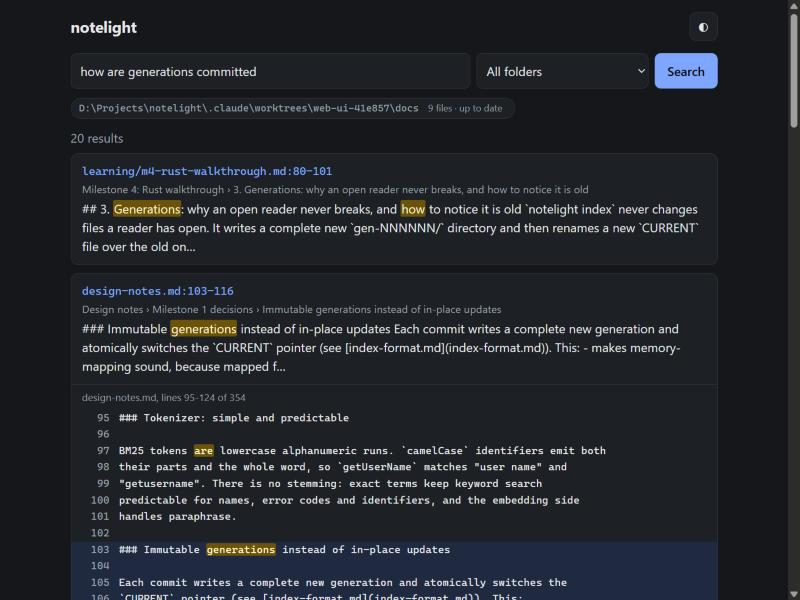

# notelight

[](https://pypi.org/project/notelight/)
[](https://github.com/searope/notelight/actions/workflows/ci.yml)
[](#license)
[](https://github.com/searope/notelight/blob/main/Cargo.toml)
[](https://github.com/searope/notelight/blob/main/pyproject.toml)

**Private semantic search over your own files, for you and your AI agents.**
A Rust retrieval engine with a Python interface, a CLI, and an MCP server, with
retrieval quality you can measure.
[How it works](https://github.com/searope/notelight/blob/main/docs/how-it-works.md) walks through the design end to end in a few minutes.
**[Try it in your browser](https://searope.github.io/notelight/)**: the same
Rust core as WebAssembly. Index a folder of your own notes or search this
repository's docs, entirely on your machine: files never leave the browser,
and the only download is the 127 MiB model, once.

> **Status: 0.2.0, alpha.** You can index a folder of notes, search it
> from the command line or [from Claude, Cursor and other AI agents over
> MCP](#use-with-claude--cursor) or [in your browser](#web-ui), include
> [PDF and DOCX files](#pdf-and-docx), and measure retrieval quality on
> public benchmarks ([results](#retrieval-quality)). See the
> [roadmap](#roadmap) and the
> [changelog](https://github.com/searope/notelight/blob/main/CHANGELOG.md).

## Why

Tools that let you "chat with your files" usually need a server, an account, or
an upload. notelight keeps everything on your machine:

- **Hybrid retrieval.** BM25 plus quantized embeddings, fused with Reciprocal
  Rank Fusion, so both exact names and paraphrased questions work. Quote a
  phrase (`"lock file"`) to put exact matches first.
- **Agent-ready.** An MCP server lets Claude, Copilot or Cursor search your notes
  and cite `path:line`.
- **Measured.** `notelight eval` reports recall@10, nDCG@10 and MRR@10 on BEIR
  datasets and on a labelled benchmark of note-style queries, for every
  quantization setting, not just anecdotes.
- **Private.** No telemetry, and no network after a one-time model download.

## Usage

Install it from PyPI (Python 3.10+), ideally into a virtual environment or
with `pipx install notelight`:

```bash
pip install notelight
```

There are prebuilt wheels for Linux (x86_64 and aarch64, glibc 2.28+),
Windows (x64) and macOS (Apple silicon and Intel), so you do not need Rust.
Two limits come from ONNX Runtime, which runs the embedding model: on Intel
Macs use Python 3.10 to 3.13, and Alpine and other musl-based Linux
distributions are not supported. On any other platform pip builds from the
source distribution, which needs [Rust](https://rustup.rs) 1.88+ (and the
MSVC C++ build tools on Windows). To install
the latest unreleased code, use
`pip install git+https://github.com/searope/notelight` (also needs Rust), or
see [Development](#development).

Index a folder of Markdown and text files, then search it. This is a real
run over this repository's `docs/` folder on a laptop CPU:

```console
$ notelight index docs
Downloading onnx/model.onnx (133 MB, one time)...
Embedding 62 new chunks...
D:\Projects\notelight\docs: 5 files (5 added, 0 changed, 0 removed), 62 chunks, 62 embedded, generation 1, 4.9s

$ notelight search "what happens when two processes index at once" -k 2
 1. design-notes.md:153-161  Design notes > Milestone 2 decisions > One writer, enforced with a lock file
    ### One writer, enforced with a lock file The core assumes a single writer: `commit` sweeps up leftovers from earlier failed commits, which would be…
 2. learning/m1-rust-walkthrough.md:82-88  Milestone 1: Rust walkthrough > 5. Validate once, then index freely (`Bm25::validate`)
    ## 5. Validate once, then index freely (`Bm25::validate`) `from_bytes` checks every offset table, every term and every posting…
```

Run `notelight index` again after editing your notes. Only new or changed
chunks are embedded. On an unchanged folder the model is never loaded, so the
re-run takes about as long as starting the CLI (0.5 s for the folder above).

| Command | What it does |
|---|---|
| `notelight index <folder>` | create or update the index for a folder |
| `notelight search "<query>" [-k 10] [--json] [-f <folder>]` | hybrid search; quote exact phrases: `'"lock file" windows'`; on a terminal the matched words are highlighted and each snippet starts near the first match (`NO_COLOR` turns colour off); `--json` returns path, line range, heading path and text for scripts and agents |
| `notelight status [<folder>] [--json]` | list indexed folders, sizes, embedders and generations |
| `notelight mcp [-f <folder>]...` | run the MCP server over stdio for AI agents ([below](#use-with-claude--cursor)) |
| `notelight serve [-f <folder>]... [--port 8765] [--open]` | search in your browser on localhost; needs `pip install "notelight[web]"` ([below](#web-ui)) |
| `notelight eval [<dataset or folder>...] [--json]` | recall@10, nDCG@10 and MRR@10 of every retrieval method on BEIR datasets, or on the bundled `notes` benchmark ([below](#retrieval-quality)) |
| `notelight version` | versions and the data directory |

Options:

- `--embedder bge-small|hashing|none`: `bge-small` (the default for a new
  index) is
  [BAAI/bge-small-en-v1.5](https://huggingface.co/BAAI/bge-small-en-v1.5),
  pinned to one revision and verified by SHA-256. `none` builds a keyword-only
  (BM25) index with no model. Without the flag, re-indexing keeps the
  embedder the index was built with, and `search` uses it automatically and
  refuses a different one.
- `--offline`: never download; fail if the model is not cached.
- Files: `.md`, `.markdown` and `.txt`, in UTF-8 or Windows-1252, plus
  `.pdf` and `.docx` with the optional extras ([below](#pdf-and-docx)). Hidden
  folders (`.git`, `.obsidian`, ...), `node_modules`, `target`, `build` and
  similar are skipped, as is anything matched by a `.notelightignore` file
  (`.gitignore` syntax) in the folder root.
- Indexes are stored in your user data directory, never in the indexed folder.
  Set `NOTELIGHT_HOME` to keep them elsewhere, or `NOTELIGHT_MODEL_CACHE` to
  share one model download.

From Python:

```python
from notelight import OnnxEmbedder, Searcher, sync

embedder = OnnxEmbedder()
sync("~/notes", embedder)
for hit in Searcher("~/notes", embedder).search("release hotfixes", k=5):
    print(hit.location, hit.heading_path)
```

### PDF and DOCX

PDF and DOCX support is optional, so the base install stays small:

```bash
pip install "notelight[pdf]"        # pypdf
pip install "notelight[docx]"       # python-docx
pip install "notelight[documents]"  # both
```

Without the extra, these files are listed as skipped with the reason
(`install notelight[pdf]`), and the next `notelight index` after installing
it picks them up. Encrypted (password-protected), scanned or image-only and
damaged PDFs are skipped with a reason; notelight does no OCR.

Citations work as for text files, with line numbers counted in the extracted
text, which `read_context` serves to agents. PDF hits also name their pages,
and DOCX headings (Heading 1-6) become heading paths:

```console
 1. papers/report.pdf:41-52 (p. 3)
    Glaciers retreat as summers warm…
 2. trips/alps.docx:9-15  Mountains > Huts
    Refuge | 2800 m…
```

## Use with Claude / Cursor

`notelight mcp` is a [Model Context Protocol](https://modelcontextprotocol.io)
server (built on the official Python SDK, over stdio). It gives an agent four
read-only tools:

| Tool | What it returns |
|---|---|
| `search(query, k=10, folder=None)` | hits with `location` (`path:line_start-line_end`), heading path, snippet and score; all indexed folders when `folder` is omitted |
| `read_context(location, context=5, folder=None)` | the cited lines plus `context` lines around them, read from disk (PDF and DOCX as extracted text, with PDF pages) |
| `list_sources()` | the indexed folders, with file and chunk counts |
| `index_status(folder=None)` | generation, chunks, embedder, size, and whether files changed since the last `notelight index` |

Index first (`notelight index <folder>`); the server only reads. It never
takes the indexer's lock, so you can re-index while it runs, and it picks up
the new generation on the next call. `read_context` only reads files that are
in the index: paths with `..`, files outside the folder, and hidden or
ignored files are refused. With no `--folder`, every indexed folder is
served; pass `--folder` (repeatable) to expose only some of them.

The configs below need the full path to the `notelight` executable, because
desktop apps do not see your shell's `PATH` or virtual environment. Find it
with `(Get-Command notelight).Source` in PowerShell or `which notelight`.

**Claude Desktop**: edit `claude_desktop_config.json` (Settings → Developer →
Edit Config; on Windows it is `%APPDATA%\Claude\claude_desktop_config.json`),
then restart Claude:

```json
{
  "mcpServers": {
    "notelight": {
      "command": "C:\\Users\\you\\.venvs\\notelight\\Scripts\\notelight.exe",
      "args": ["mcp", "--folder", "C:\\Users\\you\\Notes"]
    }
  }
}
```

**Claude Code**: add a `.mcp.json` to your project root (shared with
everyone who opens the project), or run
`claude mcp add notelight -- notelight mcp` for yourself only:

```json
{
  "mcpServers": {
    "notelight": {
      "type": "stdio",
      "command": "notelight",
      "args": ["mcp"]
    }
  }
}
```

**Cursor**: the same `mcpServers` block goes in `.cursor/mcp.json` (one
project) or `~/.cursor/mcp.json` (all projects).

Then ask, for example: *"Search my notes for how we release hotfixes and cite
the files."* The agent calls `search`, reads around the best hits with
`read_context`, and answers with locations like `runbooks/release.md:40-58`.


The tool calls and results in this GIF come from a real session: the
script indexes this repository's `docs/` folder with bge-small, starts
`notelight mcp` over stdio, calls the tools, and draws exactly what comes
back. To regenerate it after changing search code (the model must be
cached):

```powershell
pip install pillow
python scripts/make_demo_gif.py --query "what happens if I re-index while the agent is searching"
```

## Web UI

`notelight serve` opens the same search in a browser, for people rather
than agents:

```powershell
pip install "notelight[web]"
notelight serve --open             # http://127.0.0.1:8765, every indexed folder
```



Type to search (results update as you type), filter by folder, and click a
result, or move with the arrow keys or `j`/`k` and press Enter, to read the
lines around it. Each folder shows whether its index is up to date. The page
is one HTML file with plain JavaScript, no build step and no CDN, in light
and dark themes. It works at phone width too.

The server listens on 127.0.0.1 only, never changes an index, and reads only
files the index covers, through the same checks as the MCP server's
`read_context`. It refuses requests whose `Host` header is not a loopback
name, which blocks DNS-rebinding attacks from other web pages.

## Use from JavaScript

The Rust core is also an npm package, `notelight-wasm` (WebAssembly, about
130 KiB gzipped, for browsers, bundlers and Node 22+). It opens an index the
CLI built and searches it with BM25, or hybrid with a query vector you
supply, and can chunk text and build an index in memory. It does not include
the embedding model; the [browser demo](https://searope.github.io/notelight/)
adds one ([`embed.js`](https://github.com/searope/notelight/blob/main/web-demo/embed.js)).
Not yet published to npm; [the package README](https://github.com/searope/notelight/blob/main/crates/notelight-wasm/npm/README.md)
has the API, and `python scripts/build_npm.py --pack` builds the tarball.

```js
import init, { Index } from "notelight-wasm";
await init(); // fetches the .wasm in a browser; a no-op in Node
const index = new Index(manifestBytes, docsBytes, bm25Bytes, vectorsBytes);
for (const hit of index.search("lock file", queryVector /* or null */, 10)) {
  const c = index.chunk(hit.id);
  console.log(`${c.path}:${c.lineStart}`, hit.score);
}
```

## Architecture

```
            ┌────────────── notelight-core (Rust) ─────────────┐
            │ chunking · BM25 · ternary + int8 search · RRF    │
            │ memory-mapped, versioned index format            │
            └───────┬──────────────────────────────┬───────────┘
              PyO3 / maturin                 wasm-bindgen (v2)
                    │                              │
   notelight (Python package)              browser app (v2)
   embeddings via ONNX Runtime
   CLI · MCP server · eval harness · localhost UI
```

The core crate has **no Python, ML or async dependencies**. That keeps it small,
easy to test, and portable to WebAssembly. Embeddings run outside it: in
Python with ONNX Runtime, and in the browser demo with onnxruntime-web, which
gives the same vectors.

## Performance (Rust core)

Measured with `cargo bench -p notelight-core` on synthetic data, on one
thread of an Intel Core i9-10900K (Windows 11, default x86-64 target, so no
AVX). These are indicative numbers, not a tuned benchmark:

| Operation | Size | Time |
|---|---|---|
| Vector search, ternary candidates + int8 rescore (default; k=10, 200 candidates) | 100k × 384-dim | 1.5 ms |
| Same, binary candidates instead of ternary | 100k × 384-dim | 0.8 ms |
| Same, exhaustive int8 scan (reference) | 100k × 384-dim | 8.1 ms |
| BM25 query, 3 terms | 100k chunks | 0.16 ms |
| Markdown chunking | 1 MB document | 8.4 ms (≈116 MiB/s) |

The default two-stage search is about 5× faster than scanning every int8
vector, because the ternary pass compares 96 bytes per vector (sign bits and
mask) with `popcount`, and only 200 candidates are re-scored. Binary
candidates halve the scan but lose up to 0.01 nDCG@10 ([below](#retrieval-quality)). The int8 dot product keeps 16 partial sums so
the compiler can use SIMD; see
[the note on vectorizing it](https://github.com/searope/notelight/blob/main/docs/learning/m3-int8-dot-vectorization.md).

## Retrieval quality

nDCG@10 on three [BEIR](https://github.com/beir-cellar/beir) test sets with
the default bge-small embedder, measured with `notelight eval` (one command,
datasets pinned by SHA-256; see [docs/results.md](https://github.com/searope/notelight/blob/main/docs/results.md) for
recall@10, latency and the setup):

| Method | SciFact | NFCorpus | FiQA |
|---|---:|---:|---:|
| Exact float32 search (reference) | 0.713 | 0.344 | 0.403 |
| int8, every vector | 0.711 | 0.342 | 0.403 |
| Binary codes alone | 0.626 | 0.279 | 0.294 |
| Binary candidates + int8 rescore | 0.703 | 0.341 | 0.399 |
| **Ternary candidates + int8 rescore (default)** | 0.711 | 0.342 | 0.403 |
| BM25 alone | 0.678 | 0.305 | 0.238 |
| **Hybrid: BM25 + vectors, RRF (`notelight search`)** | 0.712 | 0.350 | 0.351 |

The default vector search, ternary candidates re-scored with int8, matches
exhaustive int8 to three decimals and is within 0.002 of exact float32
search; binary candidates lose up to 0.01. Hybrid fusion helps where keywords
are strong (NFCorpus) and hurts where they are weak (FiQA). Against a NumPy
implementation of the same quantized searches, the Rust core returns identical
top-10 lists; its two-stage searches are 7 to 19x faster (10 to 19x for the
ternary default), while NumPy's multi-threaded BLAS still wins the
exhaustive int8 scan by 1.3 to 1.7x (it was 5x before the int8 dot product
was vectorized).
Details and caveats are in [docs/results.md](https://github.com/searope/notelight/blob/main/docs/results.md).

BEIR's long questions are not how people search notes, so a second,
smaller benchmark is bundled: 82 short queries (keywords, identifiers and
quoted phrases, questions, paraphrases) over this repository's own docs,
labelled by line range, split into a tuning half and a held-out half. On the
held-out half, with the defaults:

| Method | nDCG@10 | MRR@10 |
|---|---:|---:|
| Ternary candidates + int8 rescore | 0.639 | 0.756 |
| BM25 alone | 0.667 | 0.692 |
| **Hybrid (`notelight search`)** | **0.715** | **0.769** |

Here keywords matter more than on BEIR: BM25 beats the embeddings on both
halves, and hybrid scores highest (its lead over the embeddings is clear;
over BM25 alone it is within noise). A sweep of chunk size and phrase weight on the tuning
half found nothing that held up on the held-out half, so the defaults stayed.
The queries were written by an LLM and there are only 41 per half; the
[notes benchmark section](https://github.com/searope/notelight/blob/main/docs/results.md#notes-benchmark)
gives the method, the per-style results and the limits.

```powershell
notelight eval                     # downloads 23 MB of data once; FiQA takes ~40 min to embed on a CPU
notelight eval notes               # the notes benchmark (tuning half); bundled, nothing to download but the model
```

## Development

Requirements: [Rust](https://rustup.rs) (stable) and Python 3.10+.

```bash
git clone https://github.com/searope/notelight
cd notelight
python -m venv .venv
# Windows: .venv\Scripts\activate   |   macOS/Linux: source .venv/bin/activate
pip install -e ".[dev,web]"    # builds the Rust extension via maturin; web: web UI + its tests
pytest                         # Python tests (no network; uses a fake embedder)
cargo test -p notelight-core   # Rust unit, integration and property tests
cargo bench -p notelight-core  # Rust benchmarks
notelight version
```

After changing Rust code, rebuild with `maturin develop --release`.

## Roadmap

| # | Milestone | Status |
|---|---|---|
| 0 | Scaffold: Rust workspace, PyO3 bindings, CI on 3 OSes | ✅ |
| 1 | Rust core: chunking, BM25, quantized search, index format | ✅ |
| 2 | Python package: embedder, incremental indexer, CLI | ✅ |
| 3 | Evaluation: BEIR results table, Rust vs NumPy baseline | ✅ |
| 4 | MCP server for AI agents | ✅ |
| 5 | Web UI, PDF/DOCX, phrase ranking; tested wheels for 5 platforms | ✅ |
| | First PyPI release ([0.1.0](https://pypi.org/project/notelight/0.1.0/)) | ✅ |
| v2 | Same core compiled to WebAssembly, in-browser app | 🚧 [live demo](https://searope.github.io/notelight/); [spike](https://github.com/searope/notelight/blob/main/docs/design-notes.md#v2-spike-the-core-in-the-browser): search runs in the browser at native speed; [queries are embedded in the page](https://github.com/searope/notelight/blob/main/docs/design-notes.md#v2-query-embeddings-in-the-browser) with the same vectors and top 10 as Python, about 10 ms per query on 4 threads (29 ms on 1); [your own folder is indexed in the page](https://github.com/searope/notelight/blob/main/docs/design-notes.md#v2-indexing-in-the-browser) and kept across reloads, with the same chunks, index bytes and top 10 as the CLI: keywords only in 41 ms for this repo's docs (207 chunks), with bge-small at about 8 chunks/s on 8 threads (native: 14), and updates embed only what changed; npm package next |

## Documentation

- [How notelight works](https://github.com/searope/notelight/blob/main/docs/how-it-works.md): the whole pipeline, from a folder of notes to a cited result, with diagrams
- [Design notes](https://github.com/searope/notelight/blob/main/docs/design-notes.md): why it is built this way
- [Index format](https://github.com/searope/notelight/blob/main/docs/index-format.md): the on-disk layout, byte by byte
- [Results](https://github.com/searope/notelight/blob/main/docs/results.md): retrieval quality and latency on BEIR and on the
  notes benchmark, with the Rust-vs-NumPy comparison
- Rust walkthroughs for readers coming from C# or Python:
  [milestone 0](https://github.com/searope/notelight/blob/main/docs/learning/m0-rust-walkthrough.md),
  [milestone 1](https://github.com/searope/notelight/blob/main/docs/learning/m1-rust-walkthrough.md),
  [milestone 2](https://github.com/searope/notelight/blob/main/docs/learning/m2-rust-walkthrough.md),
  [milestone 3](https://github.com/searope/notelight/blob/main/docs/learning/m3-rust-walkthrough.md) (plus
  [vectorizing the int8 dot product](https://github.com/searope/notelight/blob/main/docs/learning/m3-int8-dot-vectorization.md)),
  [milestone 4](https://github.com/searope/notelight/blob/main/docs/learning/m4-rust-walkthrough.md)

## License

Dual-licensed under [MIT](https://github.com/searope/notelight/blob/main/LICENSE-MIT) or [Apache-2.0](https://github.com/searope/notelight/blob/main/LICENSE-APACHE), at your option.
