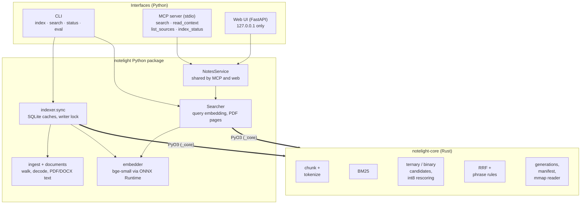
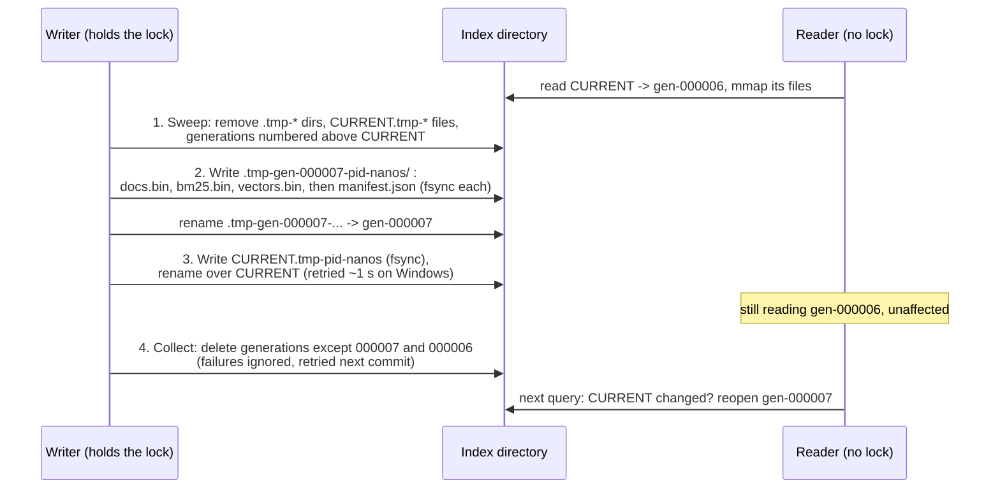
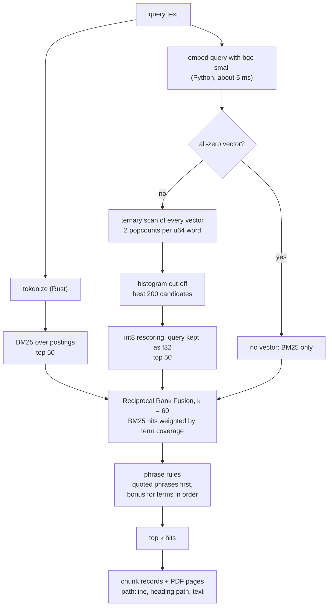

# How notelight works

notelight turns a folder of notes into a local search index that you, a
script or an AI agent can query, and it cites every result as
`path:line_start-line_end`. This page follows one folder from disk to search
result and links to the documents that go deeper:
[design notes](design-notes.md) (why), [index format](index-format.md) (the
bytes) and [results](results.md) (the measurements).

## The pieces

The work splits along one line. Everything that is a tight loop or touches
the on-disk index is Rust, in `notelight-core`. Everything that needs a
machine-learning runtime, a file-format library, SQLite or a network
protocol is Python.

The binding crate, `notelight-py`, only converts types, releases the GIL
around heavy calls and maps Rust errors to Python exceptions, so logic is
tested once, in Rust. The core only ever sees `&[f32]` vectors and never
knows which model produced them
([design notes](design-notes.md#no-ml-in-the-core)).

## Indexing a folder

`notelight index ~/notes` runs `indexer.sync`. It takes a file lock on the
index directory, so only one writer runs at a time, and readers never take
it ([why](design-notes.md#one-writer-enforced-with-a-lock-file)).

### 1. Find and decode files

`ingest.walk` lists `.md`, `.markdown` and `.txt` files, plus `.pdf` and
`.docx` when the optional extras are installed. It skips hidden folders,
`node_modules`, `target`, `build` and similar, and anything matched by a
`.notelightignore` file in `.gitignore` syntax. Text is decoded as UTF-8,
falling back to Windows-1252. Text files may be up to 10 MB and documents up
to 50 MB.

PDFs are read with pypdf and DOCX files with python-docx, both pure Python.
A PDF's pages are joined with form feeds so that every page starts on a new
line, and the line each page starts on is stored, so a hit can name its
pages (`p. 3`). DOCX headings (Heading 1 to 6) become Markdown `#` headings.
Encrypted, image-only and damaged files are skipped with a reason, and no
exception from a reader can stop a sync
([details](design-notes.md#milestone-5-decisions-pdf-and-docx)).

### 2. Chunk by structure

The core's chunker (`chunk.rs`) splits each document along its structure,
not into fixed token windows:

- a Markdown heading starts a section, and no chunk spans two sections;
- inside a section, paragraphs and fenced code blocks are packed greedily
  into chunks of at most 1,200 characters, and a block is cut only when it
  alone is too long (at line boundaries, then word boundaries);
- every chunk keeps its heading path (`Setup > Windows`) and its 1-based,
  inclusive line range.

Each chunk is an exact slice of the source, which is what makes
`path:line` citations reliable. Property tests check this over generated
documents, including Cyrillic and accented text and Windows line endings:
chunks are exact slices, in order, within the size limit, and together they
cover every non-whitespace character.

### 3. Two retrievers

**BM25.** The tokenizer (`tokenize.rs`) emits lowercase alphanumeric runs,
and splits `camelCase` identifiers into their parts while also keeping the
whole word, so `getUserName` matches both "user name" and "getusername".
There is no stemming, which keeps exact names, error codes and identifiers
predictable; the embeddings handle paraphrase
([why](design-notes.md#tokenizer-simple-and-predictable)). A chunk's indexed
text is its heading path followed by its text.

**Embeddings.** The default embedder is
[BAAI/bge-small-en-v1.5](https://huggingface.co/BAAI/bge-small-en-v1.5)
(384 dimensions), run with ONNX Runtime on the CPU. It is downloaded once
from a pinned revision and each file is checked against a pinned SHA-256.
It follows the model's reference recipe: CLS pooling, L2 normalization, and
the query instruction prefix on queries only. `--embedder none` builds a
keyword-only index with no model.

### 4. Quantize

Full-precision vectors are not stored. Each vector is written three ways
(`quant.rs`, `vectors.rs`):

| Code | Size at 384 dims | Used for |
|---|---:|---|
| sign bits | 48 bytes | the binary candidate stage |
| ternary mask | 48 bytes | with the sign bits, the ternary candidate stage (default) |
| int8 codes + one `f32` scale | 388 bytes | rescoring the candidates |

A ternary code treats each dimension as -1, 0 or +1: the sign, plus a mask
bit for dimensions whose magnitude is above 0.7 × the vector's mean absolute
value. The mask is computed from the int8 codes rather than the floats, so a
stored mask is exactly what a reader could recompute, and the property tests
check search against that recomputation
([why ternary](design-notes.md#ternary-is-the-default-and-its-masks-are-stored-schema-2)).

### 5. Commit a new generation

Every sync writes a complete, new, immutable generation of the index and then
switches a one-line `CURRENT` file to point at it. Nothing is ever updated in
place.

A reader sees the old generation or the new one, never a mix. If any step
fails, the writer removes what it created and the previous generation stays
live; after a crash, the next commit's sweep cleans up. Because mapped files
are never modified, memory-mapping them is sound, and the design works on
Windows, where a mapped file cannot be replaced or deleted. The full protocol
is in [index-format.md](index-format.md#commit-protocol).

A generation holds four files. `manifest.json` records the schema version,
the chunk count, the dimension, the embedder id and each file's size.
`docs.bin` holds the chunk records, `bm25.bin` the inverted index and
`vectors.bin` the codes above, all little-endian. Opening an index validates
every offset table, term and posting with overflow-safe arithmetic, and
integers are decoded with `from_le_bytes` rather than pointer casts, so the
query path needs no further checks and no `unsafe` code.

### Why re-indexing is cheap

Rewriting the whole index on every sync sounds expensive, but the expensive
step is embedding, and that is cached. The indexer keeps a `cache.sqlite`
next to the index ([tables](design-notes.md#full-rebuild-per-sync-with-caches-in-front)):

- **files**: a file whose size and mtime are unchanged is trusted without
  being read. If they changed but the content hash did not (a `touch`, a git
  checkout), nothing is re-chunked or re-embedded.
- **chunks** (and **pages** for PDFs): keyed by the SHA-256 of the file's
  bytes plus the chunking settings or the extractor's version, so known
  content is never chunked twice.
- **embeddings**: keyed by `sha256(model_id + "\n" + embedded text)`. A
  renamed, moved or copied file reuses its vectors, editing one section
  re-embeds only the chunks that changed, and switching models can never
  return stale vectors.
- **skipped**: files that could not be read, so they are not re-read or
  reported as new on every run.

After a successful commit, rows no current file refers to are deleted, so the
cache does not grow without bound. When nothing changed at all, no
generation is written and the model is never loaded. In the README's real
run over this repository's `docs/` folder, the first index took 4.9 s
(62 chunks) and an unchanged re-run takes about 0.5 s, roughly the CLI's
start-up time.

## Answering a query

`notelight search "lock file windows"` opens a `Searcher`. It reads the
embedder id from the manifest and loads the matching model, and it refuses a
different one with `EmbedderMismatchError` rather than returning
plausible-looking nonsense.

Everything from tokenizing to the top k runs in one Rust call
(`IndexReader::search`), on one thread, with the GIL released.

**Vector search is exhaustive, in two stages.** There is no approximate
index such as HNSW: at personal-folder scale a full scan is fast enough, and
it cannot silently miss results the way an ANN index can
([why](design-notes.md#exhaustive-search-not-an-ann-index)). The first stage
compares the query's ternary code with every stored one, 96 bytes per vector,
using popcounts over `u64` words. Distances are small integers, so the 200
best candidates are found by counting them in a histogram rather than
sorting. The second stage re-scores only those 200 with int8 codes against
the unquantized query.

**Fusion uses ranks, not scores.** BM25 scores and cosine similarities are on
different scales, and the right weighting differs per corpus. Reciprocal Rank
Fusion adds `1 / (60 + rank)` from each list, needs no tuning, and rewards
chunks both retrievers agree on. A BM25 hit's share is scaled by how many of
the query's distinct terms it contains, squared: a query that shares no word
with its answer still gets 50 keyword hits on incidental words, and at full
weight they pushed the right vector hits out
([numbers](results.md#fusion-weighting-keyword-hits-by-coverage)).

**Phrase rules run after fusion** (`phrase.rs`). Chunks containing every
quoted phrase in the query rank above all others, and a chunk that contains
all the query terms consecutively and in order gains as much as one more
first place in RRF. Checking every candidate made hybrid search 40 times
slower, so the BM25 postings, which are sorted by document id, first rule out
chunks that lack a query term with one binary search per term; only the
remaining chunks are read and tokenized
([details](design-notes.md#cheap-enough-to-always-run)).

## Where results go

All three interfaces read the same index and none of them ever writes it.

- **CLI.** `notelight search` prints ranked hits with `path:lines`, heading
  path and a snippet with the query words highlighted; `--json` gives
  scripts the same fields.
- **MCP server.** `notelight mcp` serves four read-only tools to agents over
  stdio, using the official Python SDK. It keeps one `Searcher` per folder
  and one embedder per model for its whole life, and before each use
  compares the reader's generation with `CURRENT`, so a re-index is picked up
  on the next call ([why](design-notes.md#one-searcher-per-folder-reopened-when-the-generation-changes)).
  `read_context` returns the cited lines with some context, and accepts only
  paths listed in the index's file table. That one check refuses `..`,
  absolute paths and hidden or ignored files such as `.env`, because none of
  them was indexed.
- **Web UI.** `notelight serve` puts four GET endpoints over the same
  `NotesService` as the MCP server, so caching, merging and the read check
  are shared. It binds to 127.0.0.1 only and refuses requests whose `Host`
  header is not a loopback name, which blocks DNS rebinding
  ([why](design-notes.md#localhost-only-and-checking-host)).

## What it measures

Every number below comes from the repository's own benchmarks or from
`notelight eval`, both run on an Intel Core i9-10900K under Windows 11.

**Quality** ([results.md](results.md#quality)): nDCG@10 on three BEIR test
sets with bge-small, using the same index code as `notelight search`.

| Method | SciFact | NFCorpus | FiQA |
|---|---:|---:|---:|
| Exact float32 (NumPy reference) | 0.713 | 0.344 | 0.403 |
| Ternary candidates + int8 rescore (default) | 0.711 | 0.342 | 0.403 |
| Binary candidates + int8 rescore | 0.703 | 0.341 | 0.399 |
| BM25 alone | 0.678 | 0.305 | 0.238 |
| Hybrid (`notelight search`) | 0.719 | 0.358 | 0.376 |

The default vector search matches exhaustive int8 to three decimals and is
within 0.002 of exact float32. The float32 row matches published bge-small
scores, which checks the embedder, metrics and dataset handling end to end.
Hybrid fusion is not a free win: it helps on SciFact and NFCorpus and costs
0.027 on FiQA, where BM25 is weak (0.052 before keyword hits were weighted
by term coverage). It stays the default because notes, full of exact names
and identifiers, look more like the first case, but the loss is reported as
measured. The phrase rules move nDCG@10 by at most 0.002 at any weight.

A small [notes benchmark](results.md#notes-benchmark) checks that case: 82
short queries over this repository's docs, labelled by line range. On its
held-out half BM25 (0.667 nDCG@10) is ahead of the embeddings (0.639), and
hybrid scores highest (0.759; 0.715 with plain RRF). The phrase bonus is
worth 0.02 to 0.03 there, on phrase and identifier queries.

**Speed of the Rust core** (README, `cargo bench -p notelight-core`):
criterion benchmarks on synthetic data, one thread, default x86-64 target
(no AVX).

| Operation | Size | Time |
|---|---|---|
| Ternary candidates + int8 rescore (default), k = 10 | 100k × 384 | 1.5 ms |
| Exhaustive int8 scan | 100k × 384 | 8.1 ms |
| BM25 query, 3 terms | 100k chunks | 0.16 ms |
| Markdown chunking | 1 MB | 8.4 ms |

On the BEIR datasets ([results.md](results.md#latency)), a hybrid query takes
a median of 1.31 ms on FiQA's 57,638 documents, while embedding the query
takes about 5 ms, so for a personal folder the search itself is never the
bottleneck.

**Against NumPy** ([results.md](results.md#rust-vs-numpy)): an independent
NumPy implementation of the same quantized searches returns identical top-10
lists for every query on all three datasets, which cross-checks the bit
packing, int8 rounding, ternary masks and tie-breaking. The Rust two-stage
searches are 7 to 19 times faster. NumPy still wins the exhaustive int8 scan
by 1.3 to 1.7 times, using multi-threaded BLAS over float32 copies of the
codes; that was 5 times before the int8 dot product was rewritten to
vectorize ([how](learning/m3-int8-dot-vectorization.md)).

## Design decisions worth stealing

- **Validate once, then index freely.** Opening a file checks every offset,
  term and posting with overflow-safe arithmetic, so query code can use plain
  indexing, and a corrupt file is a clean error at open rather than a panic
  mid-query ([notes](design-notes.md#reading-binary-files-without-unsafe),
  [walkthrough](learning/m1-rust-walkthrough.md#5-validate-once-then-index-freely-bm25validate)).
- **Generations instead of in-place updates.** Immutable directories plus an
  atomic pointer swap give crash safety, sound memory-mapping and lock-free
  readers, and work around Windows' refusal to replace mapped files
  ([notes](design-notes.md#immutable-generations-instead-of-in-place-updates)).
- **Cache the expensive step, rebuild the cheap one.** A full rewrite per
  sync stays cheap because embeddings are cached by the hash of the exact
  text sent to the model and the model id
  ([notes](design-notes.md#full-rebuild-per-sync-with-caches-in-front)).
- **The embedder is part of the index's identity.** The manifest records the
  pinned model id, so a search with a different model fails loudly instead of
  returning confident garbage
  ([notes](design-notes.md#the-embedder-is-part-of-the-indexs-identity)).
- **Rank-merge across folders.** Fused scores from a keyword-only index and a
  hybrid one are not comparable, so multi-folder results are merged by
  per-folder rank, then by score
  ([notes](design-notes.md#searching-several-folders-merges-by-rank)).
- **One security check, at the right place.** `read_context` only serves
  paths that are in the index's file list and never resolves a path on disk
  first ([notes](design-notes.md#read_context-reads-only-indexed-files)).
- **Cheap candidates, exact rescoring.** Ternary codes pick 200 candidates
  with popcounts and a histogram, and int8 decides the order, which matched
  exhaustive int8 on all three benchmarks
  ([notes](design-notes.md#two-stage-vector-search)).

## How it was built

- **A Rust core with no Python, ML or async dependencies.** It builds as a
  plain library, the memory map is compiled out for `wasm32` with an
  in-memory path in its place, and the same core is meant to run in a
  browser build (v2, not yet shipped). Clippy runs at `pedantic` level with
  warnings as errors, `unsafe` code is denied outside the one memory-map
  call, and every public item is documented.
- **Tested at several levels.** Rust unit tests sit next to the code,
  integration tests cover the index lifecycle, and proptest suites check
  invariants against naive reference implementations (chunk coverage, BM25
  and quantized search results, ternary masks). pytest covers the Python
  package without network access, using a deterministic hashing embedder in
  place of the model; a separate opt-in test runs the real one. CI runs the
  Python suite on Linux, Windows and macOS, the Rust tests on Linux and
  Windows (for the memory map and generation swap), and a minimum supported
  Rust version check. Release wheels for five platforms are installed into a
  clean environment and smoke-tested before publishing.
- **Independently reviewed.** The Rust core was reviewed at milestone 1, and
  milestones 2 to 4 were reviewed before the 0.1.0 release. That review found
  ten issues, from an embedder silently switching on re-index to a cache
  being emptied before the new generation committed; each was fixed with a
  regression test that fails on the old code (see the
  [changelog](../CHANGELOG.md)).
- **Explained as it went.** Each milestone ends with a Rust walkthrough for
  readers coming from C# or Python, in [docs/learning](learning/).
